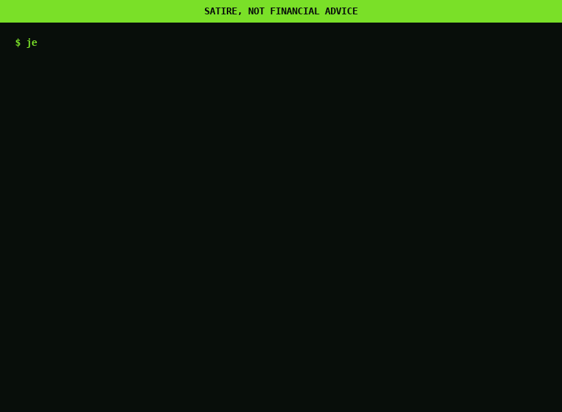

<p align="center">
  
</p>

<h1 align="center">jensen-anything</h1>

<p align="center"><sub>English · <a href="docs/translations.md#board-deck">Board Deck</a> · <a href="docs/translations.md#earnings-call">Earnings Call</a> · <a href="docs/translations.md#venture">Venture Capital</a> · <a href="docs/translations.md#linkedin">LinkedIn</a> · <a href="docs/translations.md#legalese">Legalese</a> · <a href="docs/translations.md#analyst">Sell-Side</a> · <a href="docs/translations.md#two-am">Founder at 2am</a> · <a href="docs/translations.md#pirate">Pirate</a> · <a href="docs/translations.md#accountant">Your Accountant</a></sub></p>

<p align="center"><b>Bring Jensen back to save your valuation, and prove the fundamentals did not change.</b><br>
Point it at any company's pitch and financials: it records both, pivots the story to AI infrastructure,<br>
and verifies every financial byte is identical while the implied multiple goes up. It doesn't create value; it proves it didn't.</p>

<p align="center"><b>SATIRE, NOT FINANCIAL ADVICE.</b> Unaffiliated, unendorsed, and wrong on purpose.</p>

<p align="center">
  
  
  <a href="LICENSE"></a>
  <br>
  
  
  
  
</p>

<p align="center"><a href="#quick-start"></a></p>

<p align="center">


<br>
<sub>We made these ourselves. They are not real awards.</sub></p>

<p align="center"><b><a href="#quick-start">Install</a></b> · <a href="#results">Results</a> · <a href="#how-the-number-is-computed">The math</a> · <a href="#what-it-cant-catch">What it can't catch</a> · <a href="docs/translations.md">Translations</a><br>
<sub><a href="CONTRIBUTING.md">Contributing</a> · <a href="SECURITY.md">Security</a> · <a href="CODE_OF_CONDUCT.md">Code of Conduct</a> · <a href="LICENSE">MIT</a></sub></p>

<p align="center">
  
  <br>
  <sub>Soggy Toast Logistics, a company we made up, goes from 1.12x to 3.35x revenue. Its revenue did not change. Real output from <a href="fixtures/soggy-toast-logistics">this fixture</a>.</sub>
</p>

<table>
  <tr>
    <td width="25%" valign="top">
      <b>Record</b><br>
      <code>record</code> copies your pitch and financials byte for byte and locks their SHA-256 hashes before anyone gets excited.
    </td>
    <td width="25%" valign="top">
      <b>Pivot</b><br>
      <code>pivot</code> rewrites the story. Your warehouse becomes an AI factory. Digits, URLs and code are never touched.
    </td>
    <td width="25%" valign="top">
      <b>Check</b><br>
      <code>check</code> runs six gates: the numbers must be identical, and the story must not be. One changed byte stops the rescue.
    </td>
    <td width="25%" valign="top">
      <b>Lift</b><br>
      <code>lift</code> writes the valuation rescue report and a card, each stamped as satire so a screenshot can't pass as analysis.
    </td>
  </tr>
</table>

**Every company is an AI infrastructure company if you edit the nouns.** jensen-anything applies
release-engineering discipline to the least disciplined document in business: the pitch. The rewrite
is deterministic, the arithmetic is integer-only, and the same input produces the same report byte
for byte. The business does not improve in any way. That is the part we verify.

## Results

Five fictional companies, run through the real binary from [`fixtures/`](fixtures):

| Fictional company | Trailing revenue | Financial bytes changed | EV / revenue before | EV / revenue after | Value conjured |
| --- | ---: | ---: | ---: | ---: | ---: |
| Soggy Toast Logistics | 7,311,000 | 0 | 1.12x | **3.35x** | +16,258,140 |
| Bespoke Pigeon Freight | 1,646,000 | 0 | 1.31x | **3.21x** | +3,128,035 |
| Candlewick & Daughters Fax Repair | 356,000 | 0 | 0.67x | **1.91x** | +438,456 |
| Damp Sock Laundromats | 8,978,000 | 0 | 1.47x | **4.21x** | +24,587,640 |
| Absolutely Nothing Holdings | 0 | 0 | n/a | **n/a** | +6,044,400 |

Total value conjured: **50,456,671** currency units. Total value created: **0**. All six gates pass on
all five fixtures, and a test fails if this table stops matching the tool. Absolutely Nothing Holdings
has no revenue, so it has no multiple, and its valuation rises anyway.

## Quick start

```sh
cargo install --git https://github.com/mitchthestonky/jensen-anything
jensen-anything run pitch.md --financials financials.csv --out rescue
```

Or try a fixture from a clone, one step at a time:

```sh
jensen-anything record fixtures/soggy-toast-logistics/pitch.md \
  --financials fixtures/soggy-toast-logistics/financials.csv --out rescue
jensen-anything pivot rescue
jensen-anything check rescue   # exits 1 if a single financial byte moved
jensen-anything lift rescue    # writes rescue/REPORT.md and rescue/card.svg
```

Your CSV needs this exact header, in whole currency units, oldest period first:

```csv
period,revenue,cost_of_revenue,operating_expenses,enterprise_value
2026-Q3,1861000,1215000,557000,8200000
```

## How the number is computed

1. **Trailing totals** add up the last four rows of your CSV, or all of them if there are fewer.
2. **AI density** is AI terms per million words, rounded down, before and after the pivot.
3. **Uplift** is one percent for each extra AI term per 1,000 words.
4. **Implied value** is your latest enterprise value times that uplift, rounded half up.

There is no model behind step 3. We picked it because it is funny. Every value in the report can be
reproduced by hand from your own files.

## What it can't catch

- **Whether the company is any good.** It never evaluates the business.
- **Whether your CSV is true.** It proves the numbers did not change, not that they were ever right.
- **Spelled-out numbers.** "Twelve" is prose to the number gate. Digits are checked; words are not.
- **Meaning.** Number order is verified, but a pivoted sentence can still claim something absurd. Most do.
- **Why anyone would pay the new multiple.** Nobody should.

> jensen-anything is satire. It is an independent joke project, not affiliated with, endorsed by,
> sponsored by or connected to Jensen Huang, NVIDIA Corporation or any other person or company. All
> trademarks belong to their owners. Every fixture company is fictional.

> [!WARNING]
> **This is not financial or investment advice.** The output is a joke and its multiples are
> meaningless. Do not use it to value, buy, sell, promote or describe any real company or security,
> and do not present its reports to investors, lenders, customers or regulators. Rewriting a real
> company's disclosures to imply AI exposure it does not have can be securities fraud.

<p align="center"><sub>MIT licensed. Fundamentals sold separately.</sub></p>
